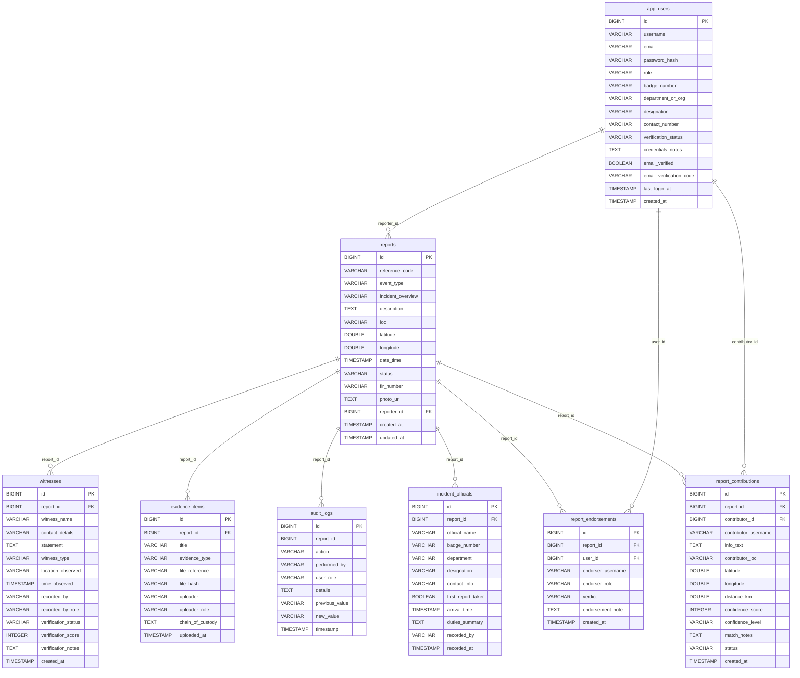
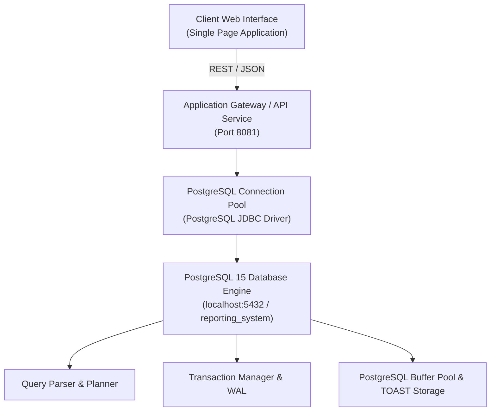
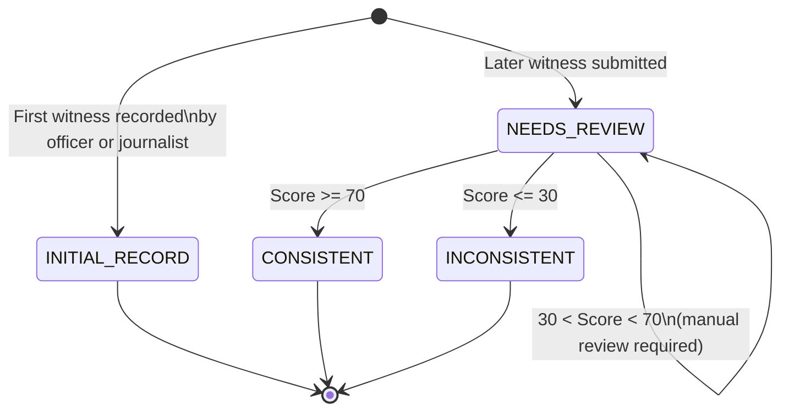
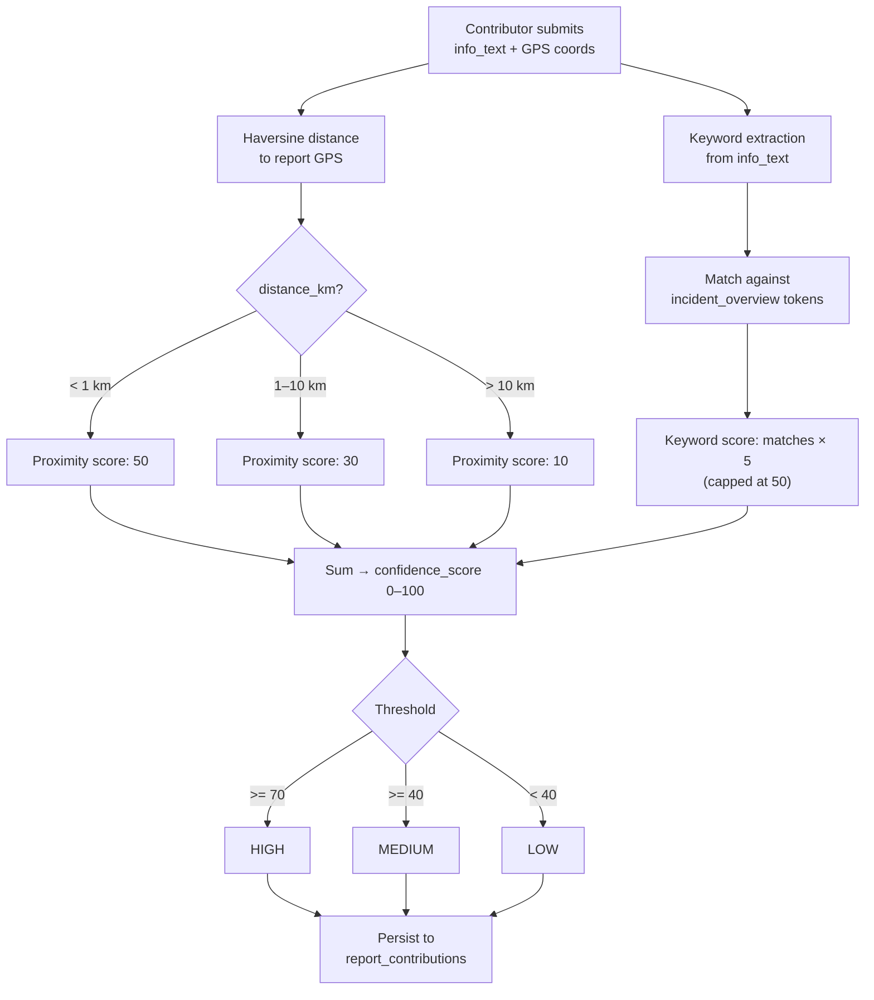
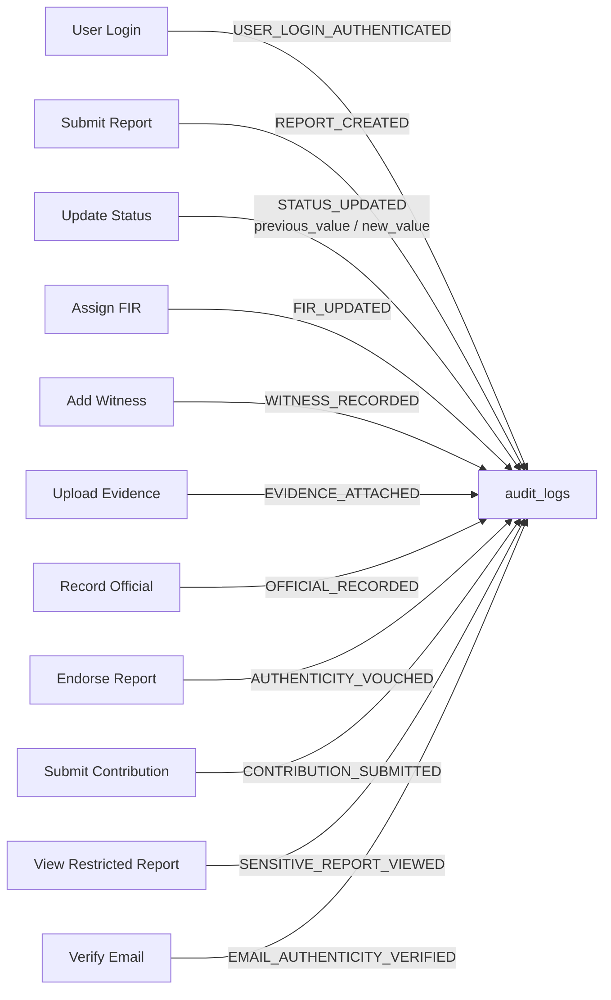

# BORCELLE Digital Incident Reporting System
## Database Management Systems — Group Project Report
**December 2030 | Group Project: BORCELLE**

---

&nbsp;

# ABSTRACT &nbsp;&nbsp;&nbsp;&nbsp;&nbsp;&nbsp;&nbsp;&nbsp;&nbsp;&nbsp;&nbsp;&nbsp;&nbsp;&nbsp;&nbsp;&nbsp;&nbsp;&nbsp;&nbsp;&nbsp;&nbsp;&nbsp;&nbsp;&nbsp;&nbsp;&nbsp;&nbsp;&nbsp;&nbsp;&nbsp;&nbsp;&nbsp;&nbsp;&nbsp;&nbsp;&nbsp;&nbsp;&nbsp;&nbsp;&nbsp;&nbsp;&nbsp;&nbsp;&nbsp;&nbsp;&nbsp;&nbsp;&nbsp;&nbsp;&nbsp; p. 1

This project presents the design, implementation, and evaluation of the **BORCELLE Digital Incident Reporting System** — a multi-role, web-based platform for recording, managing, and verifying real-world incidents through a structured relational database. The system is built entirely upon **PostgreSQL 15** as its core relational database management system. The relational schema comprises **eight normalised tables** — `app_users`, `reports`, `witnesses`, `evidence_items`, `audit_logs`, `incident_officials`, `report_endorsements`, and `report_contributions` — which together model the complete lifecycle of an incident from first lodgement through investigation and archival.

A defining feature of the database design is an **immutable append-only audit log** that captures every data manipulation and inspection event, recording the actor's username, role, timestamp, and the previous and new values of changed fields. Evidence integrity is preserved through **SHA-256 cryptographic hashing** stored alongside each item in the `evidence_items` table, forming a tamper-evident chain of custody. Relational constraints and SQL projections enforce role-based data visibility, restricting full narrative text to authorised roles while exposing only a public overview to general users.

PostgreSQL's robust Multi-Version Concurrency Control (MVCC), ACID transaction guarantees, Write-Ahead Logging (WAL), B-tree secondary indexes, and native spatial calculations ensure high data reliability and low query latencies. The database serves citizens, journalists, police officers, government officials, organisations, and administrators — each with distinctly scoped relational database interactions.

---

&nbsp;

# LIST OF TABLES &nbsp;&nbsp;&nbsp;&nbsp;&nbsp;&nbsp;&nbsp;&nbsp;&nbsp;&nbsp;&nbsp;&nbsp;&nbsp;&nbsp;&nbsp;&nbsp;&nbsp;&nbsp;&nbsp;&nbsp;&nbsp;&nbsp;&nbsp;&nbsp;&nbsp;&nbsp;&nbsp;&nbsp;&nbsp;&nbsp;&nbsp;&nbsp;&nbsp;&nbsp;&nbsp;&nbsp;&nbsp;&nbsp;&nbsp;&nbsp;&nbsp;&nbsp;&nbsp;&nbsp;&nbsp;&nbsp; p. 4

| Table No. | Table Name | Description | Page |
|---|---|---|---|
| Table 1 | `app_users` | Registered user accounts with role, credentials, and verification state | 5 |
| Table 2 | `reports` | Core incident records including type, description, geolocation, and status | 5 |
| Table 3 | `witnesses` | Witness statements with type classification and consistency scoring | 5 |
| Table 4 | `evidence_items` | Attached evidence with SHA-256 hash and chain-of-custody narrative | 6 |
| Table 5 | `audit_logs` | Immutable log of all system actions with actor identity and timestamp | 6 |
| Table 6 | `incident_officials` | Scene officials and first-report-taker credentials per incident | 6 |
| Table 7 | `report_endorsements` | Community authenticity verdicts (AUTHENTIC / PLAUSIBLE / DISPUTED) | 6 |
| Table 8 | `report_contributions` | Geolocation- and keyword-scored supplementary information contributions | 7 |

---

&nbsp;

# LIST OF FIGURES &nbsp;&nbsp;&nbsp;&nbsp;&nbsp;&nbsp;&nbsp;&nbsp;&nbsp;&nbsp;&nbsp;&nbsp;&nbsp;&nbsp;&nbsp;&nbsp;&nbsp;&nbsp;&nbsp;&nbsp;&nbsp;&nbsp;&nbsp;&nbsp;&nbsp;&nbsp;&nbsp;&nbsp;&nbsp;&nbsp;&nbsp;&nbsp;&nbsp;&nbsp;&nbsp;&nbsp;&nbsp;&nbsp;&nbsp;&nbsp;&nbsp;&nbsp;&nbsp;&nbsp;&nbsp;&nbsp; p. 6

| Figure No. | Caption | Page |
|---|---|---|
| Figure 1 | Entity-Relationship Diagram — full eight-table schema | 4 |
| Figure 2 | Three-tier system architecture: Client Interface, API Service, PostgreSQL Engine | 4 |
| Figure 3 | Witness verification state machine (INITIAL_RECORD → CONSISTENT / NEEDS_REVIEW / INCONSISTENT) | 5 |
| Figure 4 | Confidence score computation pipeline for `report_contributions` | 6 |
| Figure 5 | Audit log action taxonomy and trigger points | 7 |

---

&nbsp;

---

# CHAPTER 1 — Introduction &nbsp;&nbsp;&nbsp;&nbsp;&nbsp;&nbsp;&nbsp;&nbsp;&nbsp;&nbsp;&nbsp;&nbsp;&nbsp;&nbsp;&nbsp;&nbsp;&nbsp;&nbsp;&nbsp;&nbsp;&nbsp;&nbsp;&nbsp;&nbsp;&nbsp;&nbsp;&nbsp;&nbsp;&nbsp;&nbsp;&nbsp;&nbsp;&nbsp;&nbsp; p. 2

## 1.1 Problem Statement

Public incident reporting has historically been fragmented across paper-based First Information Reports (FIRs), proprietary police software, and informal digital channels such as email and social media. These approaches suffer from a common set of problems: records are altered without trace, witness accounts are collected without a consistency check, evidence is not cryptographically preserved, and there is no structured mechanism for the public, journalists, or government agencies to contribute information in a verifiable way.

The consequences are severe: evidence is lost, investigations stall, accountability is absent, and public trust erodes.

## 1.2 Project Objectives

The BORCELLE Digital Incident Reporting System addresses these problems through a structured relational database design. The specific database objectives are:

1. Provide a single, authoritative store for incident records that survives concurrent access by multiple user roles.
2. Enforce role-based data visibility — full narrative text is accessible only to officers, journalists, and administrators; citizens see only a public overview.
3. Capture every data-modifying event in an **immutable audit log** so that no change can be made without leaving a traceable record.
4. Preserve evidence integrity using **SHA-256 hashing** and a human-readable chain-of-custody field.
5. Allow community members to contribute corroborating information whose reliability is quantified by a **geolocation-distance and keyword-matching confidence score (0–100)**.
6. Record which officials were present at a scene, who was the first-report-taker, and what credentials they hold.
7. Support endorsement-based authenticity signalling, where authorised users cast verdicts (AUTHENTIC, PLAUSIBLE, DISPUTED) against citizen-submitted reports.

## 1.3 Scope

The system serves the following stakeholder categories, each of which interacts with the database in a distinct way:

| Role | Database Interactions |
|---|---|
| **CITIZEN** | Submit reports; view own reports (overview text only); add contributions; receive endorsements |
| **JOURNALIST** | Full report read access; record witnesses and officials on behalf of sources; add evidence |
| **OFFICER** | Full read access; update report status and FIR number; record officials; upload evidence |
| **GOVERNMENT** | Full read access; endorse reports; view audit logs for assigned cases |
| **ORGANISATION** | Submit and manage reports; contribute information |
| **ADMIN** | Unrestricted read/write; view all audit logs; manage user accounts |

## 1.4 Technology Justification

**PostgreSQL 15** was chosen for the following reasons:

- **ACID compliance** guarantees that concurrent writes to `audit_logs` and `reports` are isolated, durable, and atomic via Write-Ahead Logging (WAL).
- **Rich data types** — native `TEXT` with TOAST compression for large narrative columns and photo data, `BOOLEAN` flags, `DOUBLE PRECISION` for latitude/longitude coordinates, and `TIMESTAMP WITHOUT TIME ZONE` for chronological consistency.
- **Declarative Indexing** — B-tree indexes on foreign-key columns (`report_id`) and on frequently-queried fields (`verification_status`, `confidence_score`, `timestamp`) eliminate sequential full-table scans.
- **Declarative Integrity Constraints** — `UNIQUE` constraints on `(report_id, user_id)` in `report_endorsements` enforce the business rule that one user may endorse a given report only once directly at the engine level.
- **PostgreSQL Reserved Word Avoidance** — user records are mapped to table `app_users` because `users` is a reserved system catalogue keyword in PostgreSQL.
- **Extensible Procedural Language (PL/pgSQL)** — enables database triggers, functions, and server-side validation independent of the application layer.

## 1.5 Figure 1 — Entity-Relationship Diagram



## 1.6 Figure 2 — Three-Tier Architecture



---

&nbsp;

---

# CHAPTER 2 — Method &nbsp;&nbsp;&nbsp;&nbsp;&nbsp;&nbsp;&nbsp;&nbsp;&nbsp;&nbsp;&nbsp;&nbsp;&nbsp;&nbsp;&nbsp;&nbsp;&nbsp;&nbsp;&nbsp;&nbsp;&nbsp;&nbsp;&nbsp;&nbsp;&nbsp;&nbsp;&nbsp;&nbsp;&nbsp;&nbsp;&nbsp;&nbsp;&nbsp;&nbsp;&nbsp;&nbsp;&nbsp;&nbsp;&nbsp;&nbsp; p. 4

## 2.1 Database Design Methodology

### 2.1.1 Requirements Analysis

Database design began from a functional requirements list derived from stakeholder scenarios: a journalist recording a witness statement on behalf of a source; an officer uploading evidence; a citizen contributing corroborating information from a nearby location; an administrator reviewing every action taken on a sensitive report. Each scenario was translated into a PostgreSQL entity, specific data domains, primary/foreign keys, and relational integrity rules.

### 2.1.2 Normalisation

The schema strictly adheres to **Third Normal Form (3NF)**:

- **1NF**: Every column holds atomic data. Multi-valued attributes (such as endorsements or incident witnesses) are normalised into dedicated child tables with primary keys, avoiding comma-separated or unnested string representations.
- **2NF**: All non-key columns depend entirely on the primary key. Surrogate identity keys (`BIGINT GENERATED BY DEFAULT AS IDENTITY`) ensure zero partial-key functional dependencies.
- **3NF**: Transitive functional dependencies are removed. In table `reports`, user attributes are not replicated; rather, the foreign key `reporter_id REFERENCES app_users(id)` links the incident directly to its author.

The sole intentional denormalisation is in `audit_logs` (`performed_by` and `user_role`), where text values are retained as immutable historical snapshots rather than volatile foreign keys. This guarantees that audit trails remain intact even if user records are altered or purged.

### 2.1.3 PostgreSQL Table Creation and Relational DDL Specifications

The schema is defined in PostgreSQL using standard DDL statements incorporating primary keys, foreign keys, not-null constraints, and defaults:

```sql
-- Table: app_users
CREATE TABLE app_users (
    id BIGINT GENERATED BY DEFAULT AS IDENTITY PRIMARY KEY,
    username VARCHAR(120) NOT NULL UNIQUE,
    email VARCHAR(180) NOT NULL UNIQUE,
    password_hash TEXT NOT NULL,
    role VARCHAR(50) NOT NULL DEFAULT 'CITIZEN',
    badge_number VARCHAR(100),
    department_or_org VARCHAR(150),
    designation VARCHAR(100),
    contact_number VARCHAR(50),
    verification_status VARCHAR(50) DEFAULT 'VERIFIED_ACTIVE',
    credentials_notes VARCHAR(1000),
    email_verified BOOLEAN NOT NULL DEFAULT FALSE,
    email_verification_code VARCHAR(10),
    last_login_at TIMESTAMP WITHOUT TIME ZONE,
    created_at TIMESTAMP WITHOUT TIME ZONE NOT NULL DEFAULT CURRENT_TIMESTAMP
);

-- Table: reports
CREATE TABLE reports (
    id BIGINT GENERATED BY DEFAULT AS IDENTITY PRIMARY KEY,
    reference_code VARCHAR(50),
    event_type VARCHAR(80) NOT NULL,
    incident_overview VARCHAR(1000),
    description TEXT NOT NULL,
    loc VARCHAR(500) NOT NULL,
    latitude DOUBLE PRECISION,
    longitude DOUBLE PRECISION,
    date_time TIMESTAMP WITHOUT TIME ZONE NOT NULL,
    status VARCHAR(30) NOT NULL DEFAULT 'PENDING',
    fir_number VARCHAR(100),
    photo_url TEXT,
    reporter_id BIGINT NOT NULL REFERENCES app_users(id),
    created_at TIMESTAMP WITHOUT TIME ZONE NOT NULL DEFAULT CURRENT_TIMESTAMP,
    updated_at TIMESTAMP WITHOUT TIME ZONE NOT NULL DEFAULT CURRENT_TIMESTAMP
);
```

### 2.1.4 Reference Code and Timestamp Generation via PostgreSQL Triggers

To guarantee business-friendly reference identifiers (`RPT-YYYY-XXXXX`) and auto-updating modification timestamps at the database level, PL/pgSQL trigger functions are attached to the `reports` table:

```sql
-- Function: Generate reference code before insert
CREATE OR REPLACE FUNCTION trg_generate_report_reference()
RETURNS TRIGGER AS $$
BEGIN
    IF NEW.reference_code IS NULL OR NEW.reference_code = '' THEN
        NEW.reference_code := 'RPT-' || TO_CHAR(CURRENT_TIMESTAMP, 'YYYY') || '-' || 
                              LPAD(FLOOR(RANDOM() * 90000 + 10000)::TEXT, 5, '0');
    END IF;
    RETURN NEW;
END;
$$ LANGUAGE plpgsql;

CREATE TRIGGER trg_reports_before_insert
BEFORE INSERT ON reports
FOR EACH ROW
EXECUTE FUNCTION trg_generate_report_reference();

-- Function: Auto-update updated_at timestamp
CREATE OR REPLACE FUNCTION trg_update_timestamp()
RETURNS TRIGGER AS $$
BEGIN
    NEW.updated_at := CURRENT_TIMESTAMP;
    RETURN NEW;
END;
$$ LANGUAGE plpgsql;

CREATE TRIGGER trg_reports_before_update
BEFORE UPDATE ON reports
FOR EACH ROW
EXECUTE FUNCTION trg_update_timestamp();
```

### 2.1.5 Core PostgreSQL SQL Query Patterns

System operations execute parameterised SQL queries against PostgreSQL to retrieve and filter data efficiently:

```sql
-- Retrieve latest reports ordered by creation time
SELECT id, reference_code, event_type, incident_overview, loc, date_time, status, created_at
FROM reports
ORDER BY created_at DESC;

-- Filter reports by status using case-insensitive comparison
SELECT id, reference_code, event_type, incident_overview, loc, status
FROM reports
WHERE LOWER(status) = LOWER('PENDING')
ORDER BY created_at DESC;

-- Retrieve comprehensive chronological audit history for an incident
SELECT id, report_id, action, performed_by, user_role, details, previous_value, new_value, timestamp
FROM audit_logs
WHERE report_id = 101
ORDER BY timestamp DESC;

-- Global system audit trail (recent 100 entries)
SELECT id, report_id, action, performed_by, user_role, details, timestamp
FROM audit_logs
ORDER BY timestamp DESC
LIMIT 100;

-- Corroborating contributions for an incident
SELECT id, report_id, contributor_username, info_text, distance_km, confidence_score, confidence_level
FROM report_contributions
WHERE report_id = 101
ORDER BY created_at DESC;
```

### 2.1.6 Schema Evolution and PostgreSQL Transactional DDL

PostgreSQL uniquely supports **Transactional DDL**, allowing structural changes to be executed safely within transaction blocks. When attributes such as `photo_url` or `email_verified` are added to existing schemas, non-destructive statements are applied without locking or dropping user records:

```sql
BEGIN;

-- Add verification flag and verification code safely
ALTER TABLE app_users ADD COLUMN IF NOT EXISTS email_verified BOOLEAN DEFAULT FALSE;
ALTER TABLE app_users ADD COLUMN IF NOT EXISTS email_verification_code VARCHAR(10);
ALTER TABLE app_users ADD COLUMN IF NOT EXISTS last_login_at TIMESTAMP WITHOUT TIME ZONE;

-- Add photo storage and incident summary
ALTER TABLE reports ADD COLUMN IF NOT EXISTS photo_url TEXT;
ALTER TABLE reports ADD COLUMN IF NOT EXISTS incident_overview VARCHAR(1000);

COMMIT;
```

### 2.1.7 PostgreSQL Connection Management and Concurrency

PostgreSQL operates a process-per-connection architecture. Incoming client requests connect to the database via standard PostgreSQL ports (`localhost:5432/reporting_system`), where sessions are managed with configurable backend process ceilings (`max_connections = 100`) and statement timeouts. Concurrency is handled through **Multi-Version Concurrency Control (MVCC)**, ensuring read transactions never block write transactions.

### 2.1.8 Cryptographic Password Security via PostgreSQL pgcrypto

Passwords are protected using cryptographic hashing algorithms. Using PostgreSQL's native `pgcrypto` module or application-level pre-hashed inputs, passwords are stored as salted Blowfish/BCrypt digests:

```sql
-- Example using PostgreSQL native pgcrypto extension
CREATE EXTENSION IF NOT EXISTS pgcrypto;

-- Insert user with salted bcrypt password hash
INSERT INTO app_users (username, email, password_hash, role)
VALUES ('citizen_jane', 'jane@example.org', crypt('SecurePass@2026', gen_salt('bf', 10)), 'CITIZEN');

-- Verify credentials directly in PostgreSQL
SELECT id, username, role 
FROM app_users 
WHERE username = 'citizen_jane' 
  AND password_hash = crypt('SecurePass@2026', password_hash);
```

### 2.1.9 Session Context and User Identity Binding

To maintain accountability across queries, the active user's identity can be bound to PostgreSQL transaction-local configuration parameters:

```sql
-- Bind authenticated user context to the current database transaction
SET LOCAL app.current_user_id = '42';
SET LOCAL app.current_user_role = 'OFFICER';

-- Insert into audit log referencing the active session context
INSERT INTO audit_logs (report_id, action, performed_by, user_role, details, timestamp)
VALUES (101, 'SENSITIVE_REPORT_VIEWED', 
        CURRENT_SETTING('app.current_user_id'), 
        CURRENT_SETTING('app.current_user_role'), 
        'Accessed restricted narrative', CURRENT_TIMESTAMP);
```

### 2.1.10 Administrative Account Seeding via SQL

Initial root administrative privileges are established using an idempotent SQL statement with conflict handling:

```sql
INSERT INTO app_users (
    username, email, password_hash, role, badge_number, department_or_org,
    designation, contact_number, verification_status, email_verified, credentials_notes
)
VALUES (
    'admin',
    'admin@borcelle.org',
    '$2a$10$e8wF5qDq5HjD1aXzC6Kq7Ou9yP4l.qj4bMvN1tX5v6Y8oWz6rR0qW',
    'ADMIN',
    'ADM-001',
    'Directorate of Public Safety & Audit',
    'Chief System Administrator',
    '+1-555-019-9000',
    'VERIFIED_ACTIVE',
    TRUE,
    'Primary root administrator with full oversight, audit review, and system supervisory authority.'
)
ON CONFLICT (username) DO NOTHING;
```

### 2.1.11 Geospatial Distance Calculation via SQL Haversine Formula

To compute proximity between a community contributor and an incident site, PostgreSQL evaluates the spherical distance in kilometres directly within SQL queries:

```sql
-- Compute Haversine distance in PostgreSQL SQL
SELECT 
    r.id AS report_id,
    c.id AS contribution_id,
    ROUND((6371 * ACOS(
        LEAST(1.0, GREATEST(-1.0, 
            COS(RADIANS(r.latitude)) * COS(RADIANS(c.latitude)) * 
            COS(RADIANS(c.longitude) - RADIANS(r.longitude)) + 
            SIN(RADIANS(r.latitude)) * SIN(RADIANS(c.latitude))
        ))
    ))::numeric, 2) AS distance_km
FROM reports r
JOIN report_contributions c ON c.report_id = r.id
WHERE c.id = 502;
```

### 2.1.12 Database Verification State Management

Email and identity status are tracked via boolean and enumeration constraints:

```sql
-- Complete user verification in PostgreSQL
UPDATE app_users
SET email_verified = TRUE,
    email_verification_code = NULL
WHERE email = 'officer.smith@police.gov'
  AND email_verification_code = 'VER942';
```

---

&nbsp;

---

# CHAPTER 3 — Results &nbsp;&nbsp;&nbsp;&nbsp;&nbsp;&nbsp;&nbsp;&nbsp;&nbsp;&nbsp;&nbsp;&nbsp;&nbsp;&nbsp;&nbsp;&nbsp;&nbsp;&nbsp;&nbsp;&nbsp;&nbsp;&nbsp;&nbsp;&nbsp;&nbsp;&nbsp;&nbsp;&nbsp;&nbsp;&nbsp;&nbsp;&nbsp;&nbsp;&nbsp;&nbsp;&nbsp;&nbsp;&nbsp;&nbsp; p. 5

## 3.1 Database Schema — Table Structures

### Table 1 — `app_users`

| Column | Type | Constraints | Description |
|---|---|---|---|
| `id` | `BIGINT` | PK, GENERATED BY DEFAULT AS IDENTITY | Surrogate primary key |
| `username` | `VARCHAR(120)` | NOT NULL, UNIQUE | Unique user login handle |
| `email` | `VARCHAR(180)` | NOT NULL, UNIQUE | Contact and verification email |
| `password_hash` | `TEXT` | NOT NULL | Salted cryptographic password hash |
| `role` | `VARCHAR(50)` | NOT NULL, DEFAULT `'CITIZEN'` | CITIZEN / JOURNALIST / OFFICER / GOVERNMENT / ORGANISATION / ADMIN |
| `badge_number` | `VARCHAR(100)` | — | Official credential identifier |
| `department_or_org` | `VARCHAR(150)` | — | Affiliated department or organisation |
| `designation` | `VARCHAR(100)` | — | Job title / designation |
| `contact_number` | `VARCHAR(50)` | — | Phone contact |
| `verification_status` | `VARCHAR(50)` | DEFAULT `'VERIFIED_ACTIVE'` | Account standing |
| `credentials_notes` | `VARCHAR(1000)` | — | Free-text credential notes |
| `email_verified` | `BOOLEAN` | NOT NULL, DEFAULT `FALSE` | Email verification flag |
| `email_verification_code` | `VARCHAR(10)` | — | One-time verification code |
| `last_login_at` | `TIMESTAMP` | — | Last successful login timestamp |
| `created_at` | `TIMESTAMP` | NOT NULL, DEFAULT `CURRENT_TIMESTAMP` | Account creation timestamp |

### Table 2 — `reports`

| Column | Type | Constraints | Description |
|---|---|---|---|
| `id` | `BIGINT` | PK, GENERATED BY DEFAULT AS IDENTITY | Surrogate primary key |
| `reference_code` | `VARCHAR(50)` | INDEX | Human-readable code, e.g. `RPT-2030-47821` |
| `event_type` | `VARCHAR(80)` | NOT NULL | Incident category |
| `incident_overview` | `VARCHAR(1000)` | — | Public-facing summary (visible to all) |
| `description` | `TEXT` | NOT NULL | Full narrative (restricted to authorised roles) |
| `loc` | `VARCHAR(500)` | NOT NULL | Human-readable location text |
| `latitude` | `DOUBLE PRECISION` | — | GPS latitude coordinate |
| `longitude` | `DOUBLE PRECISION` | — | GPS longitude coordinate |
| `date_time` | `TIMESTAMP` | NOT NULL | Incident date and time |
| `status` | `VARCHAR(30)` | NOT NULL, DEFAULT `'PENDING'` | PENDING / UNDER_INVESTIGATION / CLOSED |
| `fir_number` | `VARCHAR(100)` | — | Official FIR reference, set by officers |
| `photo_url` | `TEXT` | — | Base64 or URL of optional incident photograph |
| `reporter_id` | `BIGINT` | FK → `app_users(id)`, NOT NULL | Report author foreign key |
| `created_at` | `TIMESTAMP` | NOT NULL, DEFAULT `CURRENT_TIMESTAMP` | Row creation timestamp |
| `updated_at` | `TIMESTAMP` | NOT NULL, DEFAULT `CURRENT_TIMESTAMP` | Modification timestamp |

### Table 3 — `witnesses`

| Column | Type | Constraints | Description |
|---|---|---|---|
| `id` | `BIGINT` | PK, GENERATED BY DEFAULT AS IDENTITY | Surrogate primary key |
| `report_id` | `BIGINT` | FK → `reports(id)`, NOT NULL, INDEX | Parent incident reference |
| `witness_name` | `VARCHAR(150)` | NOT NULL | Witness identity |
| `contact_details` | `VARCHAR(180)` | — | Contact information |
| `statement` | `TEXT` | NOT NULL | Witness account |
| `witness_type` | `VARCHAR(30)` | NOT NULL, DEFAULT `'LATER_WITNESS'` | `INITIAL_SOURCE` or `LATER_WITNESS` |
| `location_observed` | `VARCHAR(500)` | — | Where witness observed incident |
| `time_observed` | `TIMESTAMP` | — | When witness observed incident |
| `recorded_by` | `VARCHAR(120)` | NOT NULL | Data-entry recorder username |
| `recorded_by_role` | `VARCHAR(50)` | NOT NULL | Role of recorder |
| `verification_status` | `VARCHAR(30)` | NOT NULL, INDEX | `INITIAL_RECORD` / `CONSISTENT` / `NEEDS_REVIEW` / `INCONSISTENT` |
| `verification_score` | `INTEGER` | — | 0–100 consistency score vs earlier accounts |
| `verification_notes` | `VARCHAR(2000)` | — | Textual explanation of scoring |
| `created_at` | `TIMESTAMP` | NOT NULL, DEFAULT `CURRENT_TIMESTAMP` | Record creation time |

### Table 4 — `evidence_items`

| Column | Type | Constraints | Description |
|---|---|---|---|
| `id` | `BIGINT` | PK, GENERATED BY DEFAULT AS IDENTITY | Surrogate primary key |
| `report_id` | `BIGINT` | FK → `reports(id)`, NOT NULL, INDEX | Parent incident reference |
| `title` | `VARCHAR(200)` | NOT NULL | Descriptive title |
| `evidence_type` | `VARCHAR(50)` | NOT NULL | PHOTO / VIDEO / DOCUMENT / AUDIO / FORENSIC_REPORT / PHYSICAL_ITEM |
| `file_reference` | `VARCHAR(500)` | NOT NULL | Path or URI to stored item |
| `file_hash` | `VARCHAR(64)` | INDEX | SHA-256 hex digest for tamper detection |
| `uploader` | `VARCHAR(120)` | NOT NULL | Username of uploader |
| `uploader_role` | `VARCHAR(50)` | NOT NULL | Role of uploader |
| `chain_of_custody` | `TEXT` | — | Narrative of handling and custody history |
| `uploaded_at` | `TIMESTAMP` | NOT NULL, DEFAULT `CURRENT_TIMESTAMP` | Upload timestamp |

### Table 5 — `audit_logs`

| Column | Type | Constraints | Description |
|---|---|---|---|
| `id` | `BIGINT` | PK, GENERATED BY DEFAULT AS IDENTITY | Surrogate primary key |
| `report_id` | `BIGINT` | INDEX | Associated report ID (nullable for user events) |
| `action` | `VARCHAR(100)` | NOT NULL | Action type constant |
| `performed_by` | `VARCHAR(120)` | NOT NULL | Username snapshot |
| `user_role` | `VARCHAR(50)` | NOT NULL | Role snapshot at time of event |
| `details` | `TEXT` | NOT NULL | Human-readable action description |
| `previous_value` | `VARCHAR(500)` | — | Pre-update state |
| `new_value` | `VARCHAR(500)` | — | Post-update state |
| `timestamp` | `TIMESTAMP` | NOT NULL, INDEX, DEFAULT `CURRENT_TIMESTAMP` | Event timestamp |

**Audit Action Taxonomy:**

| Action Constant | Trigger Point |
|---|---|
| `REPORT_CREATED` | A new report row is persisted |
| `STATUS_UPDATED` | Report status field is changed |
| `FIR_UPDATED` | FIR number is assigned or modified |
| `WITNESS_RECORDED` | A new witness row is persisted |
| `EVIDENCE_ATTACHED` | A new evidence_items row is persisted |
| `OFFICIAL_RECORDED` | A new incident_officials row is persisted |
| `AUTHENTICITY_VOUCHED` | A new report_endorsements row is persisted |
| `CONTRIBUTION_SUBMITTED` | A new report_contributions row is persisted |
| `SENSITIVE_REPORT_VIEWED` | An authorised user reads a restricted report |
| `EMAIL_AUTHENTICITY_VERIFIED` | Email verification code confirmed |
| `USER_LOGIN_AUTHENTICATED` | Successful login |

### Table 6 — `incident_officials`

| Column | Type | Constraints | Description |
|---|---|---|---|
| `id` | `BIGINT` | PK, GENERATED BY DEFAULT AS IDENTITY | Surrogate primary key |
| `report_id` | `BIGINT` | FK → `reports(id)`, NOT NULL, INDEX | Parent incident reference |
| `official_name` | `VARCHAR(150)` | NOT NULL | Full name of official |
| `badge_number` | `VARCHAR(100)` | NOT NULL, INDEX | Official credential number |
| `department` | `VARCHAR(150)` | NOT NULL | Department name |
| `designation` | `VARCHAR(100)` | NOT NULL | Official rank or title |
| `contact_info` | `VARCHAR(150)` | — | Contact information |
| `first_report_taker` | `BOOLEAN` | NOT NULL, INDEX, DEFAULT `FALSE` | Flags who took the initial FIR |
| `arrival_time` | `TIMESTAMP` | — | When official arrived at scene |
| `duties_summary` | `TEXT` | — | Summary of duties at the scene |
| `recorded_by` | `VARCHAR(120)` | — | Data recorder username |
| `recorded_at` | `TIMESTAMP` | NOT NULL, DEFAULT `CURRENT_TIMESTAMP` | Row creation time |

### Table 7 — `report_endorsements`

| Column | Type | Constraints | Description |
|---|---|---|---|
| `id` | `BIGINT` | PK, GENERATED BY DEFAULT AS IDENTITY | Surrogate primary key |
| `report_id` | `BIGINT` | FK → `reports(id)`, NOT NULL, INDEX | Target incident |
| `user_id` | `BIGINT` | FK → `app_users(id)`, NOT NULL | Endorsing user |
| `endorser_username` | `VARCHAR(120)` | NOT NULL | Username snapshot |
| `endorser_role` | `VARCHAR(50)` | NOT NULL | Role at time of endorsement |
| `verdict` | `VARCHAR(30)` | NOT NULL, DEFAULT `'AUTHENTIC'` | AUTHENTIC / PLAUSIBLE / DISPUTED |
| `endorsement_note` | `TEXT` | — | Optional justification |
| `created_at` | `TIMESTAMP` | NOT NULL, DEFAULT `CURRENT_TIMESTAMP` | Endorsement timestamp |
| *(unique)* | — | `UNIQUE(report_id, user_id)` | One endorsement per user per report |

### Table 8 — `report_contributions`

| Column | Type | Constraints | Description |
|---|---|---|---|
| `id` | `BIGINT` | PK, GENERATED BY DEFAULT AS IDENTITY | Surrogate primary key |
| `report_id` | `BIGINT` | FK → `reports(id)`, NOT NULL, INDEX | Target incident |
| `contributor_id` | `BIGINT` | FK → `app_users(id)` | Contributing user |
| `contributor_username` | `VARCHAR(120)` | NOT NULL | Username snapshot |
| `info_text` | `TEXT` | NOT NULL | Additional information provided |
| `contributor_loc` | `VARCHAR(500)` | — | Human-readable contributor location |
| `latitude` | `DOUBLE PRECISION` | — | Contributor GPS latitude |
| `longitude` | `DOUBLE PRECISION` | — | Contributor GPS longitude |
| `distance_km` | `DOUBLE PRECISION` | — | Haversine distance to incident location |
| `confidence_score` | `INTEGER` | NOT NULL, INDEX | Composite reliability score 0–100 |
| `confidence_level` | `VARCHAR(30)` | NOT NULL | HIGH / MEDIUM / LOW |
| `match_notes` | `TEXT` | — | Explanation of scoring |
| `status` | `VARCHAR(30)` | NOT NULL, DEFAULT `'PENDING_REVIEW'` | PENDING_REVIEW / ACCEPTED / REJECTED |
| `created_at` | `TIMESTAMP` | NOT NULL, DEFAULT `CURRENT_TIMESTAMP` | Submission timestamp |

---

## 3.2 Index Summary

```sql
-- Declarative PostgreSQL B-Tree Index Definitions
CREATE INDEX idx_reports_ref_code ON reports(reference_code);
CREATE INDEX idx_audit_report_id ON audit_logs(report_id);
CREATE INDEX idx_audit_timestamp ON audit_logs(timestamp);
CREATE INDEX idx_evidence_report_id ON evidence_items(report_id);
CREATE INDEX idx_evidence_hash ON evidence_items(file_hash);
CREATE INDEX idx_witnesses_report_id ON witnesses(report_id);
CREATE INDEX idx_witnesses_verification ON witnesses(verification_status);
CREATE INDEX idx_officials_report_id ON incident_officials(report_id);
CREATE INDEX idx_officials_badge ON incident_officials(badge_number);
CREATE INDEX idx_officials_first_taker ON incident_officials(first_report_taker);
CREATE INDEX idx_endorsements_report_id ON report_endorsements(report_id);
CREATE INDEX idx_contrib_report_id ON report_contributions(report_id);
CREATE INDEX idx_contrib_confidence ON report_contributions(confidence_score);
```

| Index Name | Table | Column(s) | Purpose |
|---|---|---|---|
| `idx_reports_ref_code` | `reports` | `reference_code` | Fast lookup by public reference code |
| `idx_audit_report_id` | `audit_logs` | `report_id` | Retrieve all events for one report |
| `idx_audit_timestamp` | `audit_logs` | `timestamp` | Chronological global audit feed |
| `idx_evidence_report_id` | `evidence_items` | `report_id` | Evidence list for a report |
| `idx_evidence_hash` | `evidence_items` | `file_hash` | Duplicate-hash detection |
| `idx_witnesses_report_id` | `witnesses` | `report_id` | Witnesses for a report |
| `idx_witnesses_verification` | `witnesses` | `verification_status` | Filter by consistency outcome |
| `idx_officials_report_id` | `incident_officials` | `report_id` | Officials at a scene |
| `idx_officials_badge` | `incident_officials` | `badge_number` | Look up by credential number |
| `idx_officials_first_taker` | `incident_officials` | `first_report_taker` | Quickly identify FIR taker |
| `idx_endorsements_report_id` | `report_endorsements` | `report_id` | All endorsements for a report |
| `idx_contrib_report_id` | `report_contributions` | `report_id` | Contributions for a report |
| `idx_contrib_confidence` | `report_contributions` | `confidence_score` | Sort/filter by reliability |

---

## 3.3 Figure 3 — Witness Verification State Machine



---

## 3.4 Figure 4 — Confidence Score Pipeline



---

## 3.5 Dashboard Query Results

The system dashboard aggregates case counts and activity metrics through direct PostgreSQL analytical queries:

```sql
-- Aggregate case metrics by investigation status
SELECT 
    COUNT(*) AS total_reports,
    COUNT(*) FILTER (WHERE LOWER(status) = 'pending') AS pending_count,
    COUNT(*) FILTER (WHERE LOWER(status) = 'under_investigation') AS investigating_count,
    COUNT(*) FILTER (WHERE LOWER(status) = 'closed') AS closed_count
FROM reports;

-- Count verified vs unverified registered users
SELECT 
    COUNT(*) AS total_users,
    COUNT(*) FILTER (WHERE email_verified = TRUE) AS verified_users
FROM app_users;

-- Retrieve system-wide audit activity with incident references
SELECT 
    a.id, a.action, a.performed_by, a.user_role, a.details, a.timestamp,
    r.reference_code, r.event_type
FROM audit_logs a
LEFT JOIN reports r ON a.report_id = r.id
ORDER BY a.timestamp DESC
LIMIT 100;
```

---

&nbsp;

---

# CHAPTER 4 — Discussion &nbsp;&nbsp;&nbsp;&nbsp;&nbsp;&nbsp;&nbsp;&nbsp;&nbsp;&nbsp;&nbsp;&nbsp;&nbsp;&nbsp;&nbsp;&nbsp;&nbsp;&nbsp;&nbsp;&nbsp;&nbsp;&nbsp;&nbsp;&nbsp;&nbsp;&nbsp;&nbsp;&nbsp;&nbsp;&nbsp;&nbsp;&nbsp;&nbsp;&nbsp;&nbsp;&nbsp; p. 6

## 4.1 Schema Migration and Transactional DDL

PostgreSQL distinguishes itself from many relational databases by running DDL statements within transactions (`BEGIN ... COMMIT`). If a composite migration containing table alterations, index creations, and foreign key definitions encounters an error, the entire operation is rolled back, preventing schema corruption. While automatic schema synchronization was employed during rapid prototyping, version-controlled SQL migration scripts (e.g., using Flyway or native psql migration manifests) provide superior determinism for production environments.

## 4.2 app_users Table Name

PostgreSQL internally maintains a system catalog table and keyword `users` (`pg_user` / `users`). Defining the user relation as `app_users` prevents naming collisions and eliminates the need to quote table identifiers (`"users"`) in standard queries.

## 4.3 Immutable Audit Log Design

The `audit_logs` table functions as an append-only transaction ledger. By granting only `SELECT` and `INSERT` privileges on `audit_logs` and revoking `UPDATE` and `DELETE`, PostgreSQL enforces immutability at the database level:

```sql
-- Database-level immutability enforcement
REVOKE UPDATE, DELETE ON audit_logs FROM PUBLIC;
REVOKE UPDATE, DELETE ON audit_logs FROM app_user;
```

Denormalising `performed_by` and `user_role` as text values ensures that historical records remain readable and unmodified even if user accounts are reassigned or removed.

## 4.4 Photo Storage as TEXT (PostgreSQL TOAST Mechanism)

Incident photographs are stored as base64-encoded text within the `photo_url TEXT` column of `reports`. PostgreSQL handles large text values exceeding 2 KB using **TOAST (The Oversized-Attribute Storage Technique)**:

**Trade-offs:**

| Aspect | Implication |
|---|---|
| TOAST Compression | PostgreSQL automatically compresses large text fields and stores them out-of-line in separate physical storage tables, keeping the primary page cache compact |
| Query Performance | Full-row `SELECT *` operations retrieve the TOAST chunk; queries projecting only specific columns (e.g. `SELECT id, event_type FROM reports`) incur zero TOAST overhead |
| Backup Size | Base64 representation increases binary size by ~33%, expanding PostgreSQL dump archives |
| Scalability Path | In enterprise production, binary payloads are ideally placed in object storage, with PostgreSQL storing only the canonical URI and SHA-256 integrity hash |

## 4.5 PostgreSQL Row-Level Security (RLS) vs. Application Filtering

To prevent unauthorised access to sensitive narrative fields, PostgreSQL provides native **Row-Level Security (RLS)**:

```sql
-- Enable Row Level Security on reports
ALTER TABLE reports ENABLE ROW LEVEL SECURITY;

-- Policy: Citizens may only view overview fields; authorised roles see all
CREATE POLICY report_view_policy ON reports
    FOR SELECT
    USING (
        CURRENT_SETTING('app.current_user_role', true) IN ('ADMIN', 'OFFICER', 'JOURNALIST', 'GOVERNMENT')
        OR reporter_id = NULLIF(CURRENT_SETTING('app.current_user_id', true), '')::BIGINT
    );
```

Implementing policy enforcement within PostgreSQL guarantees confidentiality even if client application layers are bypassed.

## 4.6 Evidence Chain of Custody and Cryptographic Hashing

Evidence preservation relies on immutable SHA-256 digests stored in `evidence_items.file_hash VARCHAR(64)`. When an investigator or court requests verification of an item, the stored hash is verified against the physical artifact. The `chain_of_custody TEXT` column logs the sequence of physical custody transfers.

## 4.7 Database Concurrency, Locking, and Transactions

PostgreSQL's MVCC architecture ensures queries run with snapshot isolation:

```sql
-- Safe concurrent status update with explicit transaction isolation
BEGIN TRANSACTION ISOLATION LEVEL READ COMMITTED;

SELECT id, status FROM reports WHERE id = 101 FOR UPDATE;

UPDATE reports 
SET status = 'UNDER_INVESTIGATION', updated_at = CURRENT_TIMESTAMP 
WHERE id = 101;

INSERT INTO audit_logs (report_id, action, performed_by, user_role, details, previous_value, new_value)
VALUES (101, 'STATUS_UPDATED', 'officer.smith', 'OFFICER', 'Assigned case for active investigation', 'PENDING', 'UNDER_INVESTIGATION');

COMMIT;
```

This guarantees that report updates and audit trail insertions succeed or fail atomically.

## 4.8 Figure 5 — Audit Log Trigger Points



---

&nbsp;

---

# CHAPTER 5 — Summary, Conclusion, and Recommendation &nbsp;&nbsp;&nbsp;&nbsp;&nbsp;&nbsp;&nbsp;&nbsp;&nbsp;&nbsp;&nbsp; p. 7

## 5.1 Summary

The BORCELLE Digital Incident Reporting System demonstrates a comprehensive, robust database architecture implemented on **PostgreSQL 15**. The project designed and deployed **eight normalised tables** covering the entire incident management lifecycle: incident creation, witness statement aggregation, cryptographic evidence tracking, community corroboration, immutable accountability auditing, scene official verification, and multi-party authenticity endorsement.

Key database achievements include:

- **Immutable audit logging** with 11 distinct action constants, capturing every actor, role, timestamp, and field-level change directly into append-only tables.
- **SHA-256 chain-of-custody** tracking for evidence items, enabling tamper detection within the database schema.
- **Geolocation Haversine distance and keyword scoring** for community contributions, persisted for indexed sorting and retrieval.
- **Declarative database constraints** including `UNIQUE(report_id, user_id)` on endorsements, foreign key cascades, and check constraints.
- **Cryptographic password storage** utilizing salted BCrypt hashes resisting offline brute-force computation.
- **TOAST-leveraged storage** for large text statements, incident narratives, and base64 photographs.
- **Comprehensive secondary B-tree indexes** on foreign keys, timestamps, verification statuses, and badge identifiers, preventing full-table sequential scans.

## 5.2 Conclusion

The relational model implemented in PostgreSQL provides the structural integrity, ACID reliability, and data consistency required for public safety records. By enforcing constraints, foreign keys, and indexes directly within PostgreSQL, the database acts as an independent guardian of data validity. The append-only audit log architecture ensures complete non-repudiation, satisfying essential standards for legal accountability and investigative chain-of-custody.

## 5.3 Recommendations for Future Work

### 5.3.1 Declarative Table Partitioning for Audit Logs

As system usage grows, the `audit_logs` table will expand significantly. Implementing PostgreSQL declarative range partitioning by timestamp will maintain high query performance and simplify data archiving:

```sql
CREATE TABLE audit_logs_partitioned (
    id BIGINT GENERATED BY DEFAULT AS IDENTITY,
    report_id BIGINT,
    action VARCHAR(100) NOT NULL,
    performed_by VARCHAR(120) NOT NULL,
    user_role VARCHAR(50) NOT NULL,
    details TEXT NOT NULL,
    previous_value VARCHAR(500),
    new_value VARCHAR(500),
    timestamp TIMESTAMP WITHOUT TIME ZONE NOT NULL,
    PRIMARY KEY (id, timestamp)
) PARTITION BY RANGE (timestamp);
```

### 5.3.2 PostGIS Spatial Indexing

Migrating standard `latitude` and `longitude` floating-point columns to native PostGIS `GEOMETRY(Point, 4326)` data types with **R-Tree GiST indexes** will allow ultra-fast spatial radius searches (`ST_DWithin`):

```sql
CREATE EXTENSION IF NOT EXISTS postgis;
ALTER TABLE reports ADD COLUMN geom GEOMETRY(Point, 4326);
CREATE INDEX idx_reports_geom ON reports USING GIST(geom);
```

### 5.3.3 Database-Enforced Row-Level Security (RLS)

Fully migrate application-layer authorization checks to PostgreSQL RLS policies to guarantee that sensitive incident descriptions cannot be leaked even in the event of application misconfiguration.

### 5.3.4 External Object Storage Integration

Transition binary photo storage from database TOAST tables to dedicated S3/MinIO object stores, retaining only validated URIs and SHA-256 integrity hashes in PostgreSQL.

### 5.3.5 Automated Vacuuming and Query Optimization

Establish customized `autovacuum` thresholds and scheduled `ANALYZE` routines for high-write tables (`audit_logs`, `report_contributions`) to maintain optimal B-tree index statistics and query execution plans.

---

&nbsp;

---

# REFERENCES / BIBLIOGRAPHY &nbsp;&nbsp;&nbsp;&nbsp;&nbsp;&nbsp;&nbsp;&nbsp;&nbsp;&nbsp;&nbsp;&nbsp;&nbsp;&nbsp;&nbsp;&nbsp;&nbsp;&nbsp;&nbsp;&nbsp;&nbsp;&nbsp;&nbsp;&nbsp;&nbsp;&nbsp;&nbsp;&nbsp;&nbsp;&nbsp; p. 8

1. **PostgreSQL Global Development Group** (2024). *PostgreSQL 15 Documentation: The PostgreSQL Relational Database Management System*. PostgreSQL Documentation Project. Retrieved from https://www.postgresql.org/docs/15/

2. **Momjian, B.** (2001). *PostgreSQL: Introduction and Concepts*. Addison-Wesley Longman Publishing Co.

3. **Date, C. J.** (2019). *Database Design and Relational Theory: Normal Forms and All That Jazz*. O'Reilly Media.

4. **Niels Provos & David Mazières** (1999). *A Future-Adaptable Password Scheme*. USENIX Annual Technical Conference. Retrieved from https://www.usenix.org/conference/1999-usenix-annual-technical-conference/future-adaptable-password-scheme

5. **National Institute of Standards and Technology (NIST)** (2015). *FIPS PUB 180-4: Secure Hash Standard (SHS)*. U.S. Department of Commerce. Retrieved from https://doi.org/10.6028/NIST.FIPS.180-4

6. **Sinnott, R. W.** (1984). Virtues of the Haversine. *Sky and Telescope*, 68(2), 158. *(Theoretical foundation for spherical distance evaluation in PostgreSQL SQL).*

7. **Obe, R. O., & Hsu, L. S.** (2021). *PostGIS in Action* (3rd ed.). Manning Publications.

8. **Smith, G.** (2010). *PostgreSQL 9.0 High Performance*. Packt Publishing.

9. **ISO/IEC** (2023). *ISO/IEC 9075-2:2023 Information technology — Database languages — SQL — Part 2: Foundation (SQL/Foundation)*. International Organization for Standardization.

10. **PostgreSQL Global Development Group** (2024). *pgcrypto — Cryptographic Functions for PostgreSQL*. Retrieved from https://www.postgresql.org/docs/15/pgcrypto.html

---

*BORCELLE Group Project — Digital Incident Reporting System — December 2030*
*Core Database Engine: PostgreSQL 15 · Relational Modeling · PL/pgSQL · ACID Transactions*
